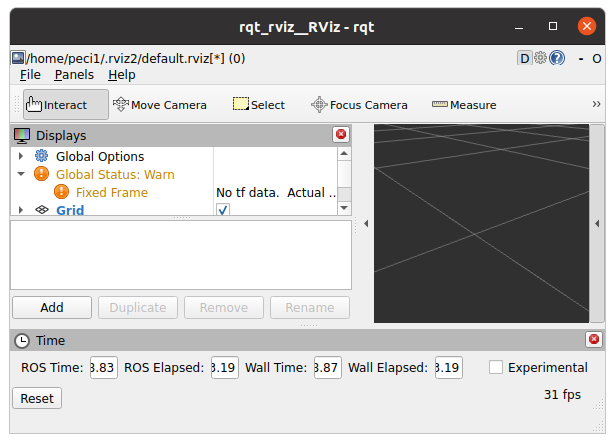
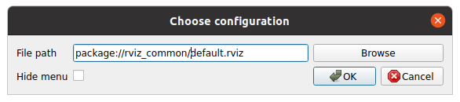

<!--
SPDX-License-Identifier: BSD-3-Clause
SPDX-FileCopyrightText: Czech Technical University in Prague
-->

# rqt\_rviz

rqt\_rviz is a ROS package that can embed RViz in RQt windows.

It is able to embed multiple RViz instances in a single RQt window.

## Usage

Either insert the plugin into a running RQt GUI from menu Plugin -> Visualization -> rqt\_rviz,
or call the standalone launcher from command line:

    ros2 run rqt_rviz rqt_rviz

## Settings

The plugin has the following settings:

| Setting        | Description                         |
|----------------|-------------------------------------|
| display_config | Name of the RViz configuration file |
| hide_menu      | Hide the RViz menu bar              |

The name of the RViz config file takes either relative paths, absolute paths, or URIs of
type `package://ros_package_name/path/to/file.rviz`. It is remembered as entered, i.e. the
settings dialog shows the very same name again, while RViz itself works with the resolved
file system path.

A name which cannot be resolved - because the ROS package does not exist, because the file
is missing, or because it is not a readable file - is reported to the user, and the
previously loaded configuration stays active.
However, if the user accepts the displayed warning, the invalid configuration is
still remembered by the plugin - this allows e.g configuring the plugin in advance,
before you create the respective RViz display config file.
